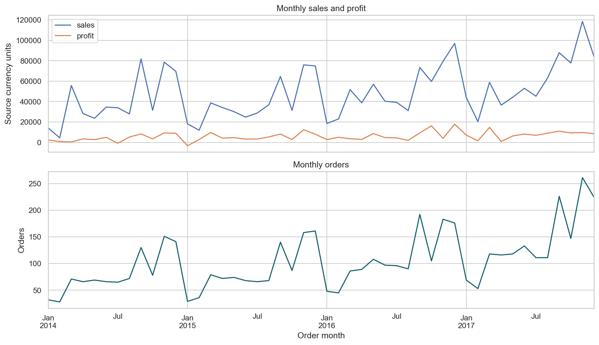
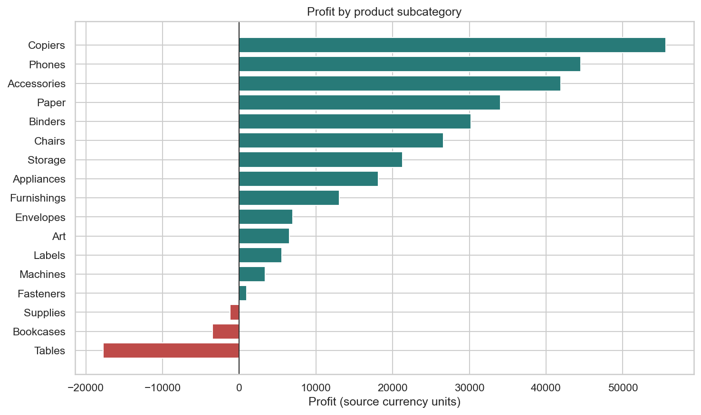

# Customer analytics and return-risk prototype

A reproducible analysis of customer, order and returns data: validated joins, business reporting, customer-cluster statistics and a return-risk model evaluated on later orders.

## Explore the project

| Deliverable | Link |
| --- | --- |
| Executive report | [Read online](https://bdjjo.github.io/customer-analytics-portfolio/) |
| Complete executed analysis | [Read online](https://bdjjo.github.io/customer-analytics-portfolio/analysis.html) |
| Executed Jupyter notebook | [Open notebook](notebooks/customer_analytics.ipynb) |
| Downloadable project | [Download ZIP](downloads/customer-analytics-github-ready.zip) |
| Executive report source | [Markdown report](reports/executive_report.md) |
| Batch-scoring prototype | [Python code](src/score_batch.py) |

## Findings from the historical extract

The observations cover **2014–2017**, with **9,994 order lines**, **5,009 orders** and **793 purchasing customers**. Every order has matching customer information. Sales total 2,297,200.86 and recorded profit totals 286,397.02 in the source's unspecified currency units, giving a 12.47% aggregate margin. There are 296 orders in the returns file (5.91%). These are historical dataset results, not current company performance.

The highest-profit subcategory is Copiers; Tables has the lowest recorded profit. These findings support investigation of pricing, discounts and product mix; they do not establish causal effects.





Additional plots: [margin by discount band](reports/figures/discount_margin.png) · [holdout risk-score distributions](reports/figures/holdout_risk_scores.png).

## Methods and model evidence

* Preserve identifiers as text and parse dates explicitly; report data-quality checks without silently discarding records.
* Validate customer and return joins as many-to-one. Ambiguous customer locations are not attributed to orders.
* Use customer-cluster bootstrap intervals and a cluster permutation test, accounting for repeated customer orders.
* Compare a no-skill baseline, logistic regression and random forest. Select using 2016 validation, then evaluate once on the later 2017 holdout.
* The selected random forest achieved average precision **0.114** versus holdout prevalence **0.062**, and ROC AUC **0.641**. The top 10% ranked orders had 15.4% observed return precision and captured 24.8% of observed returns.

Return dates and label-maturity windows are unavailable. This is a retrospective prototype with unverified outcome timing, not a production-deployed service. Full definitions, limitations and departmental actions appear in the notebook and report.

## Setup and run
1. Extract the ZIP and open PowerShell in the extracted project directory.
2. Create and activate an isolated Python 3.11 environment:

   ```powershell
   py -3.11 -m venv .venv
   .\.venv\Scripts\Activate.ps1
   python -m pip install -r requirements.txt
   ```

3. Place `customers.csv`, `orders.csv`, and `returns.csv` in `data/raw/`. Source data are not distributed in this repository or the ZIP; use your authorized local copies.
4. Run `jupyter notebook`, open `notebooks/customer_analytics.ipynb`, and select the Python kernel from the activated environment.
5. Select **Kernel → Restart Kernel and Run All Cells**. Outputs appear in `reports/` and `models/`.

Source CSVs and trained model files are excluded from Git. Aggregate reports and executed notebook outputs can still reveal business-sensitive data: inspect them and confirm publication rights before sharing.

The analysis has already been run on the supplied files. The executed notebook retains its tables and figures, and `reports/customer_analytics.html` provides a browser-readable copy. `reports/executive_report.html` is a concise management brief. The dated observations cover 2014–2017; they should not be presented as current results.

## Batch-scoring prototype
After training, provide a CSV with one row per order and columns `sales,units,line_count,category_count,discount_weighted,month,segment,ship_mode`. Optional `order_reference` is echoed in the output. The fields must be known at order placement and calculated exactly as in the notebook. Run:

```bash
python src/score_batch.py --input path/to/orders_to_score.csv --output path/to/scores.csv
```

`discount_weighted` is sum(line discount × line units) / sum(line units), in [0,1]. Categories unseen during training are accepted and encoded as all zero. Output scores are probabilities from the prototype; they are not decisions or validated deployment recommendations. Only load trusted joblib files.

## Analysis design
The source order table is at line level; order-level outcomes are built separately. Customer location records cannot be linked reliably to order lines, so only segment and country are joined after consistency checks. Missing return-file matches are treated as not observed returned, assuming a complete extract. Return dates and item-level refund amounts are not available. The last year is a later holdout; the prior year selects the candidate using average precision. Labels lack event dates, so maturity and temporal availability are unverified. A production release needs updated data, mature outcomes, calibration, monitoring, security and stakeholder review.
